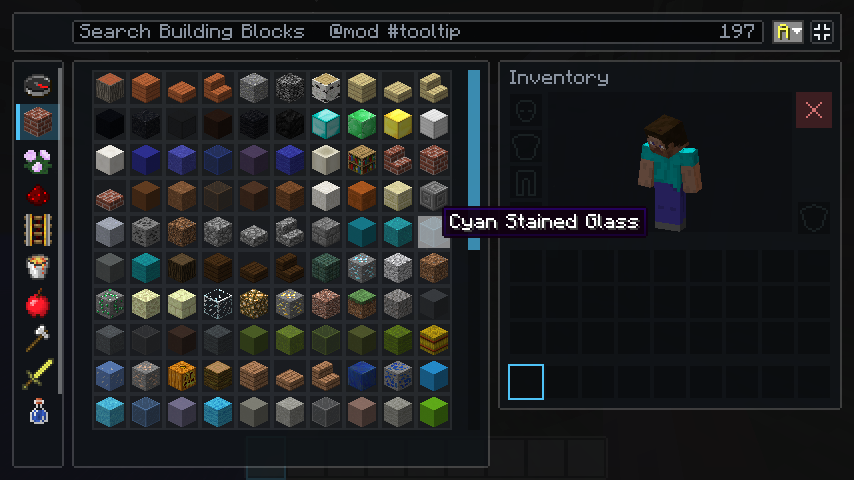

# LDIC: Limitless Development: Immersive Client

A client-only Minecraft **1.12.2 Forge** mod for modpacks that want to control what players see:
a themeable **loading screen**, a fully customizable **main menu**, themed **options**, **pause**
and **world-loading** screens, full-screen **inventories** with search and sorting, and a
redesigned **hotbar**.


LDIC is Mica Technologies' replacement for Custom Loading Screen (AlexIIL) and Custom Main Menu
(lumien231). It is a clean-room implementation with its own theme format: their behaviour was
studied, but none of their code, config samples or textures were copied.

**Documentation:** https://mica-technologies.github.io/LDIC/


## Features

### Loading screen

- Takes over Forge's splash thread from its first frame, so the screen animates smoothly
  through every loading stage. Falls back to Forge's own splash if anything goes wrong.
- Accurate progress: Forge's nested progress bars become one weighted, never-backwards
  percentage, with an ETA learned from the previous launch.
- Built-in themes (cinematic, traditional, minimal, console), or your own: images,
  fonts, slideshows, animation, music (Ogg Vorbis) and loading tips.
- Optional logo card and photosensitivity notice before loading; hold Space to skip.
- An F3 details panel (stages, mods, memory) that remembers whether it was open.

### Main menu, options, pause and world loading

- Themes are JSON: anchored layout that survives resizing and GUI scale changes, buttons,
  images, panoramas, slideshows, server status, web news, music and actions.
- A full expression language for animation and live values (time, player, servers, memory),
  compiled once per theme load and sandboxed.
- `extends` lets a theme inherit from a built-in one and change only what it needs.
- Live reload while you edit, with every theme problem reported by file and JSON path,
  never as a crash.
- Other mods' buttons keep working: LDIC's screens extend the vanilla screen classes, and
  LDIC never hides a mod's button on the options or pause screens.

### Inventory



- **Full-screen inventories**, toggled by a button beside the panel (or a key) and remembered.
  Creative becomes one large screen: every tab in a sidebar (no tab pages), one search box,
  an item grid as large as the window allows, and the whole player inventory beside it, where
  Shift-click drops a full stack straight in. Survival, chests, furnaces and the rest scale up
  to the largest crisp size that fits.
- Search box on **every** creative tab, not only Search Items (click the title or press Ctrl+F).
- Richer search everywhere: several words in any order, `@mod`, `#tooltip`, `-exclude`.
- Sort any tab by tab order, name, mod or item id, ascending or descending. Each tab
  remembers its choice. Useful in modpacks, where registration order leaves tabs in disarray.
- Styled to match: LDIC's inventory and hotbar take their accent colour from the menu theme.

### Hotbar

- A **modern** hotbar (translucent, with a gliding accent selection), or vanilla's.
- **Size** from 50% to 200%, independent of GUI scale. Health, food, armour, air, experience and
  the held item's name scale with it and keep their places.
- **Auto-hide**: once you have been moving for a moment, the hotbar group slides away; changing
  slot, picking things up, taking damage or opening a screen brings it back. A key (H) shows or
  hides it at any time.
- Settings in game under **Mods > LDIC > Config**.

See the wiki: [creative search and sort](https://mica-technologies.github.io/LDIC/inventory/creative/),
[full-screen inventory](https://mica-technologies.github.io/LDIC/inventory/full-screen/),
[hotbar](https://mica-technologies.github.io/LDIC/inventory/hotbar/).

### On the way

- **Theme-styled inventories:** inventory backgrounds and slots drawn from the theme, plus
  search highlighting in survival.
- **HUD:** SUM's general-purpose HUD elements move into LDIC, with a OneConfig settings page.

## Installing

Drop the jar into `mods/`. It needs [MixinBooter](https://www.curseforge.com/minecraft/mc-mods/mixin-booter).
LDIC is client-only: servers do not need it, and it joins any server.

Packs configure LDIC in `config/ldic/`: `settings.json` holds the pack's switches and
`player.json` holds each player's own choices, which pack updates never overwrite. See
[Settings](https://mica-technologies.github.io/LDIC/help/settings/).

## Building

There is no `java` on the PATH in the usual dev setup; point Gradle at a JDK 17+:

```sh
JAVA_HOME=/path/to/jdk17 ./gradlew build      # compile, unit tests, jar in build/libs/
JAVA_HOME=/path/to/jdk17 ./gradlew test       # unit tests only
JAVA_HOME=/path/to/jdk17 ./gradlew runClient  # dev client
```

The build uses [GregTechCEu Buildscripts](https://github.com/GregTechCEu/Buildscripts)
(RetroFuturaGradle), like the other Mica Technologies 1.12.2 mods. The mod itself targets Java 8.

## Architecture at a glance

```
com.micatechnologies.minecraft.ldic
├── expr/        # the theme expression language: typed parser, constant folding, built-ins
├── theme/       # theme loading, extends chains, merging, validation (never throws)
├── ui/          # evaluates and draws a theme screen in one pass per frame
├── loading/     # ProgressModel: Forge's bar stack to a weighted percentage and ETA
├── inventory/   # search queries, item ordering, hotbar visibility, full-screen layout
├── mixin/       # splash takeover, world-loading screens, inventories, hotbar, accessors
└── client/      # everything that touches Minecraft
    ├── render/      # one GL backend per thread (GlStateManager on the main thread, raw GL11 on the splash thread)
    ├── menu/        # menu, options and pause screens, actions, world loading
    ├── loading/     # the loading screen on Forge's splash thread
    ├── inventory/   # creative search and sort, full-screen screens and scaling
    ├── hud/         # the hotbar
    └── audio/       # Ogg Vorbis through Java Sound, never OpenAL
```

`expr`, `theme`, `ui`, `loading` and `inventory` use no Minecraft types, so the parts most likely
to be subtly wrong (expressions, theme merging, layout, progress, search and sort) are
unit-tested on a plain JVM.

## CI

- **Pull requests:** compile and unit tests.
- **Push to `main`:** builds and publishes a pre-release with checksums. A manual dispatch cuts a
  full `YYYY.MM.DD` release.
- The wiki in `docs/` is built with MkDocs (`--strict`) and published to GitHub Pages.

## License

LGPL 2.1; see [LICENSE](LICENSE).
