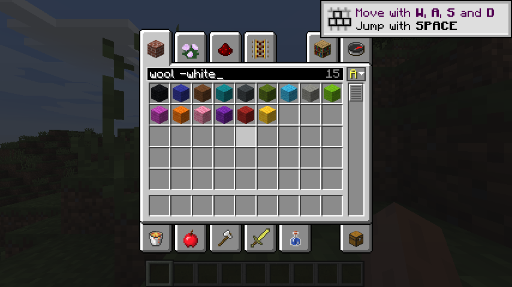
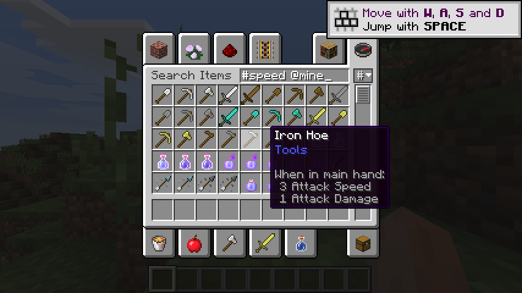

# Creative inventory: search and sort

LDIC adds search to every creative tab and lets each tab sort its items. Nothing needs to be
set up. It works with any mod's tabs, and other mods' items stay in the tabs they chose.

{ .shot }

## Searching a tab

Every item tab can now be searched, not only **Search Items**. Click the tab's title, or press
**Ctrl+F**, and start typing. The box shows how many items match. **Esc** leaves the box (press
it again to close the inventory), and a right click on the box clears it.

The **Search Items** tab searches every item, as in vanilla, and understands the same syntax.

## Search syntax

Words are separated by spaces, and an item must match all of them, in any order.

| You type | Matches |
| --- | --- |
| `oak` | items whose name or id (`minecraft:log`) contains "oak" |
| `oak slab` | items matching both words: "Oak Wood Slab" |
| `@quark` | items from a mod whose id or name contains "quark" |
| `#speed` | items with "speed" anywhere in their tooltip |
| `-slab` | leaves out items matching "slab"; works with `@` and `#` too (`-@minecraft`) |

Matching ignores case and colour codes. On the Search Items tab, a single plain word uses
vanilla's own fast search; anything else uses LDIC's.

{ .shot }

## Sorting a tab

The small button in the panel's top-right corner sorts the current tab:

- **Left click** picks the next order: `#` tab order, `A` name, `@` mod, `i` item id.
- **Right click** reverses it. The arrow points up for ascending and down for descending.
- Hover over it to see the order and how many items are shown.

Ties keep the tab's own order, so sorting by mod keeps each mod's items the way that mod listed
them. Name sorting compares numbers by value ("Wool 2" before "Wool 10").

Each tab remembers its order between sessions, in `config/ldic/player.json`:

```json
"creative_sort": {
  "buildingBlocks": { "order": "name", "descending": false }
}
```

Tabs are named by their internal label. A tab left on its own order is not listed.
