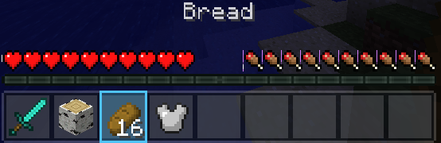

# Hotbar

LDIC redraws the hotbar in its own style and lets each player choose its size and whether it
hides itself.

{ .shot }

## Style

The **modern** style (the default) is a translucent dark bar with an accent outline on the
selected slot that glides from slot to slot. The accent comes from the menu theme's `accent`
constant, so the game matches the menu. **Vanilla** keeps Minecraft's own textures and still
honours size and auto-hide.

## Size

**Size** (50% to 200%) scales the hotbar together with everything that sits on it: health,
armour, food, air, the experience bar, mount bars and the held item's name. They keep their
places relative to each other at any size, independent of the GUI scale.

## Auto-hide

With **auto-hide** on, the hotbar group slides off the bottom of the screen once you have been
moving for the **hide after moving** time (2 seconds by default). Standing still never hides
it. It comes back when something happens worth seeing:

- you change slot, or something in your hotbar or offhand changes (picking items up, using them);
- you take damage, your food changes, you level up, or you are under water;
- you open any screen.

The **Show/hide hotbar** key (H by default; Controls, under LDIC) hides it at once or brings
it back. With auto-hide off, the key simply hides the hotbar until you press it again.

## Settings

In game: **Mods**, LDIC, **Config**. These are saved in your `config/ldic/player.json`; a pack
sets its own defaults in `settings.json` (see [Settings](../help/settings.md)).

```json
"hotbar": { "style": "modern", "scale": 1.0, "auto_hide": false, "hide_delay": 2.0 }
```
