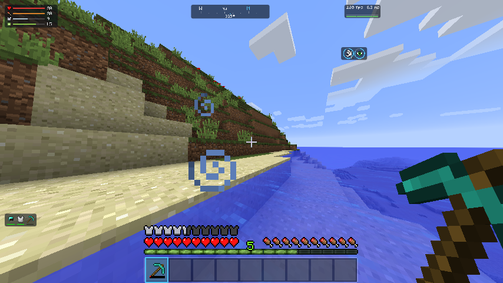

# HUD

With [OneConfig](https://polyfrost.org/projects/oneconfig/) in the pack, LDIC adds a set of
information HUDs and its own OneConfig page. Open OneConfig with **Right Shift** (or
`/oneconfig`) and pick **Limitless Development: Immersive Client**.

Without OneConfig, LDIC works as usual and these two parts are simply off; the log says so.

## The HUDs

Each is a small text box you drag into place in OneConfig's **Edit HUD** screen, with its own
options (colours, units, which parts to show) on its settings page.

| Group | HUDs |
| --- | --- |
| Information | Coordinates, Facing Direction, Clock, Biome, Day Counter, Real-Life Date, Server IP, Resource Pack, Game Mode, Block Above, Height Limit, Looking-At Block, Light Level |
| Player | Pitch, Yaw, Speed, Saturation, Armor Durability, Health, Hunger, Experience, Active Effects, Tool Durability |
| Performance | FPS, Frame Time, TPS, Memory, Ping |
| Counters | CPS, Click Counter, Blocks Placed, Session Playtime |
| Custom Text | Ten slots for your own text, with `%placeholders%`: `%player%`, `%x%`, `%y%`, `%z%`, `%dim%`, `%biome%`, `%server%`, `%time%`, `%realtime%`, `%date%`, `%fps%`, `%direction%` |

## Visual HUDs

The same information, drawn instead of written, in less space. Each follows the menu theme's
[HUD colours](#theme-colours).

{ .shot }

| HUD | Shows |
| --- | --- |
| Compass Tape | A strip of ticks and N / NE / E ... that slides as you turn, the heading under a marker in the middle (and in degrees, optionally). Replaces Facing Direction and Yaw. |
| Vitals Bars | Health (with absorption), food, armour and experience as slim bars with their icons and a number. |
| Gear Durability | Worn armour and both hands' items, each with a green-to-red durability bar; a nearly broken item's bar blinks. |
| Effect Rings | Active effects as icons in a ring that drains as the effect runs out, with the level when it is above I. Hides vanilla's effect icons while it is on (an option). |
| Frame Time Graph | FPS and average frame time over a bar per recent frame: green below 16.7 ms (60 fps), yellow below 33 ms, red above, with the 60 fps line drawn in. |

## Presets

**HUD Presets** on LDIC's page apply a **style** to every HUD at once, and a **layout** that
switches HUDs on and places them. Both are starting points: drag and tweak freely afterwards;
applying a preset again overwrites those tweaks.

| Style | Look |
| --- | --- |
| Default | OneConfig's own look: grey background, plain text |
| Minimal Brackets | No background, values in brackets |
| Clean Professional | Navy panels, soft cyan text |
| Stylish Glass | Frosted panels with a white edge |
| Compact Light | Plain text, no chrome |
| Retro Terminal | Green on black, a console window each |
| Realistic Game HUD | The smallest: plain text with a shadow (the default) |
| High Contrast | Yellow on black, a little larger, for bright scenes and low vision |
| Theme | The menu theme's [HUD colours](#theme-colours); follows the theme when it changes |
| Compact Glass | Stylish Glass at the smallest size |
| Compact Pill | Small dark rounded pills |

All styles are compact (0.4 to 0.6 of OneConfig's default size). **Visual Compact** is the layout
for the visual HUDs: compass top-centre, vitals top-left, frame time and effects top-right, gear
bottom-left.

## Theme colours

A menu theme can set the HUD's colours with three [constants](../themes/theme-files.md):

```json
"constants": {
  "accent": "#4FC3F7",
  "hud_background": "#A00C1218",
  "hud_text": "#E8ECF0",
  "hud_accent": "accent"
}
```

Each falls back to a dark translucent panel, light text and the theme's `accent`. The Theme style
and the visual HUDs use them; when the menu theme changes (or reloads), the Theme style picks up
the new colours without moving anything. Horizon, launcher and premiere set all three. SUM's
HUDs follow the same colours under its Theme style when LDIC is installed.

## Moving from SUM

These HUDs used to be part of SUM. SUM keeps the ones that read its own server data (wallet,
bank, vault, phone number, pocket, plot info, jobs, loyalty, nearest roamer, border distance,
now playing).

- On the first start with LDIC's page, a player's positions and options for the moved HUDs are
  copied from SUM's settings, so nothing has to be set up again.
- SUM's and LDIC's presets have the same names and positions, and each leaves room for the
  other's rows, so applying the same layout on both pages gives one tidy layout.

## Hotbar and inventory settings

LDIC's page also has the [hotbar](hotbar.md) and [inventory](full-screen.md) settings. They are
the same settings as LDIC's own Config screen (Mods list) and are saved in
`config/ldic/player.json` either way.
