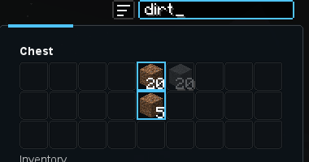

# Survival search and sort

Every survival inventory screen (your inventory, chests, furnaces, other mods' inventories)
gets a small **search box** just above the panel. Click it, or press **Ctrl+F**, and type: slots
whose item does not match are dimmed and matching ones are outlined. It uses the same
[search syntax](creative.md#search-syntax) as the creative inventory (`@mod`, `#tooltip`,
`-exclude`). **Esc** or **Enter** stops typing; a right click on the box clears it. The search
stays while you play, so it carries from chest to chest.

{ .shot }

## Sort

The button left of the search box sorts:

- on your **inventory** screen, the main inventory (your hotbar is left alone);
- on a **chest**, shulker box, hopper, dispenser or dropper, the container's own slots.

Part stacks of the same item are merged, then everything is ordered by item. Sorting works by
clicking slots for you, exactly as you would, so it is safe on any server and other players
see nothing unusual. It does nothing while you are holding a stack.
