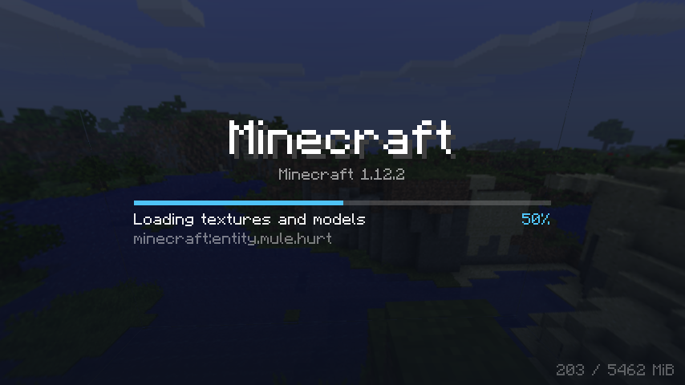
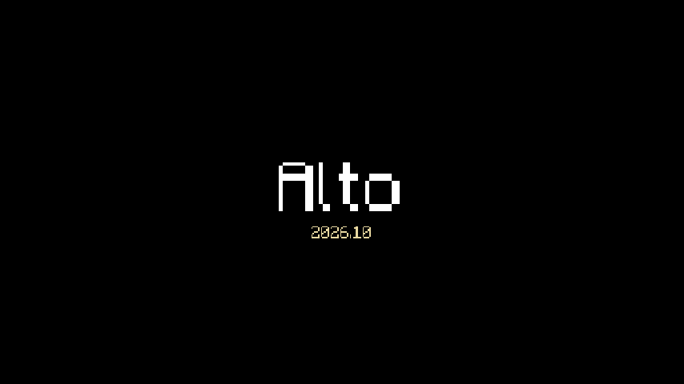
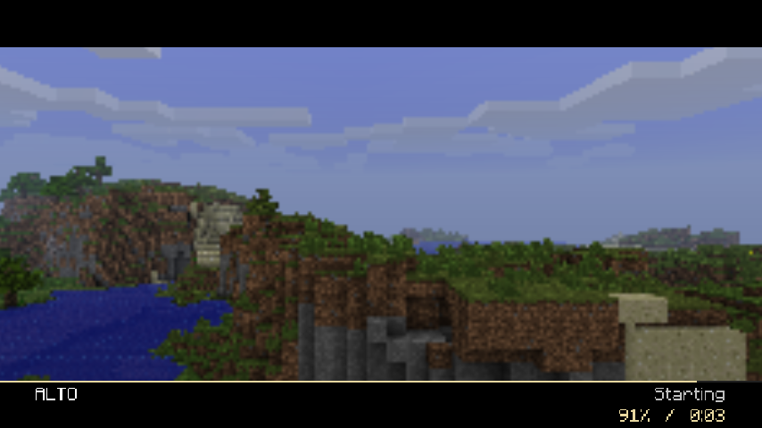
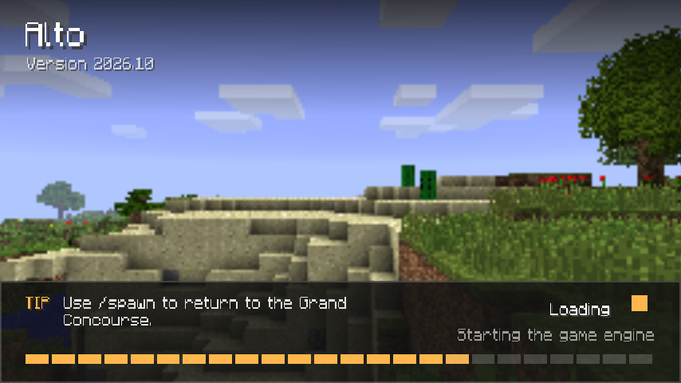
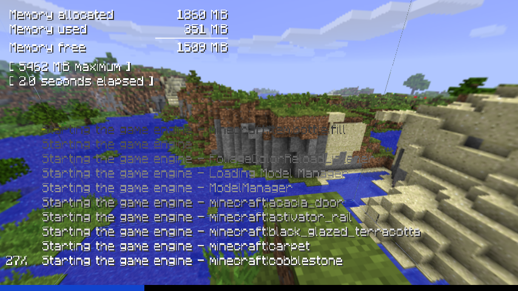

# Loading screen

LDIC replaces Forge's startup screen with a theme: the same format, elements and expressions as
the [main menu](../themes/theme-files.md), plus live progress.

The theme comes from `config/ldic/loading.json`, which LDIC creates on first start as a one-line
theme extending `builtin:minimal`. Change the `extends` line to use another built-in theme, or add
your own elements.

!!! info "Forge's splash must be enabled"
    LDIC draws on Forge's own loading-screen thread, so `config/splash.properties` must have
    `enabled=true` (the default). Forge writes `enabled=false` there after a splash crash; LDIC
    respects that and stays off until it is set back.

## Built-in loading themes

### minimal

`builtin:minimal` (the default): a dim panorama, the pack name, a slim progress bar with the stage
and current step, an ETA, rotating tips and memory use.

{ .shot }

### cinematic

`builtin:cinematic`: a title card, then full-screen scenes that slowly pan, zoom and crossfade
behind letterbox bars, with captions and a hairline progress bar. Replace the scenes with
screenshots of your own world:

```json
{
  "ldic": 1,
  "extends": "builtin:cinematic",
  "constants": { "captions": "'The Grand Concourse|Harbour at dusk|Terminal City'" },
  "screens": { "main": { "elements": [
    { "id": "scenes", "images": ["scenes/concourse.png", "scenes/harbour.png", "scenes/terminal.png"] }
  ] } }
}
```

{ .shot }
{ .shot }

### traditional

`builtin:traditional`: key art, a tips panel along the bottom, a spinner, animated "Loading…" and
a segmented progress bar. Override the `art` element's `images` with your own.

{ .shot }

### console

`builtin:console`: a rotating panorama behind a log of loading steps that scrolls up and fades,
a full-width progress bar on the bottom edge, and memory and elapsed time in the corner.

{ .shot }

## Loading values

On top of the menu's general [game values](../themes/game-values.md) (`time`, screen size,
`mem.*`, `pack_name`, `clock()`, …), a loading theme has:

| Name | Type | Value |
| --- | --- | --- |
| `progress` | number | 0–1, smooth and never going backwards. Weighted by how long each step took last launch, so it moves evenly. |
| `progress_raw` | number | The unsmoothed value |
| `stage`, `stage_count` | number | Current step 1–7 (0 before Forge starts), and 7 |
| `status` | string | The step in words: `Constructing mods`, `Pre-initialization`, `Starting the game engine`, `Initialization`, `Post-initialization`, `Finishing up`, `Starting the game`, then `Ready` |
| `sub_status` | string | What is being worked on: a mod name, a texture, a model |
| `task` | string | The title of Forge's innermost progress bar |
| `eta` | number | Seconds left, from last launch's timings; `-1` on the first launch |
| `mods_found` | number | Mods discovered so far |
| `reduced_motion` | bool | The player asked for less motion; see [`player.json`](../help/settings.md#playerjson) |
| `tip()`, `tip(i)`, `tip_count()` | | Tips from `config/ldic/tips.txt` (one per line, `#` for comments). `tip()` is random per launch; `tip(floor(time / 8))` rotates. |
| `bar_count()`, `bar_title(i)`, `bar_message(i)`, `bar_progress(i)` | | Forge's raw progress bars, outermost first |
| `duration(seconds)` | string | `m:ss`, for ETAs |

Translations (`translate`) are not available yet while the game is loading.

## Screens before the loading screen

A loading theme can show screens before `main`, an intro or a logo sting, each crossfading into
the next:

```json
"crossfade": 1.0,
"sequence": [
  { "screen": "studio_logo", "seconds": 3, "once": true },
  { "screen": "title_card", "seconds": 4 }
],
"screens": { "studio_logo": { "elements": [ … ] }, "title_card": { … }, "main": { … } }
```

With `"once": true` a screen is shown only the first time a player loads the game. Loading
carries on underneath. If it finishes during the sequence, the game moves on to the menu.

## Fonts and images while loading

The game's resource manager does not exist yet, so:

- `minecraft` font is LDIC's own copy of the vanilla font (ASCII only; other characters draw as `?`).
  For other languages or symbols, use a `.ttf`/`.otf` font in your theme.
- `namespace:path` images come from the game's built-in resources, not resource packs. Put your own
  images next to `loading.json` instead.
- `panorama` cannot blur on the loading screen.

## Previewing a loading theme

Loading may be over in seconds on a fast machine. With `"debug": true` in
[settings](../help/settings.md):

- `loading.hold_seconds` keeps the loading screen up that long after loading ends;
- LDIC saves `screenshots/ldic-loading-NNs.png` every 2 seconds.
