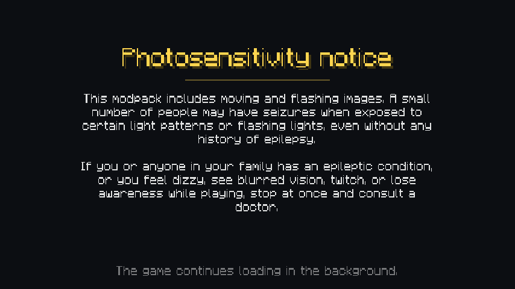

# Photosensitivity notice

Packs with flashing or fast-moving loading screens or menus can show a photosensitivity notice
before anything else. It is off by default; turn it on in `config/ldic/settings.json`:

```json
"photosensitivity_notice": { "enabled": true, "always": false, "seconds": 7 }
```

| Key | Default | Meaning |
| --- | --- | --- |
| `enabled` | `false` | Show the notice |
| `always` | `false` | Every launch, instead of only until the player has seen it once |
| `seconds` | `7` | How long it stays up (2–60) |

The notice is always shown for its full time. If the game finishes loading sooner, the menu waits
for it. The game keeps loading behind it, so it costs no time otherwise. Whether a player has seen
it is stored in `config/ldic/cache/seen.json`.

{ .shot }

## Changing the wording

Copy the built-in notices theme to `config/ldic/notices.json` and edit the `photosensitivity`
screen. It is an ordinary theme screen, so any element works. The built-in one is in the LDIC jar
at `assets/ldic/themes/notices/theme.json`.

## Flashing themes and reduced motion

- A theme that flashes should say so with `"flashing": true` at its top level. LDIC then logs a
  warning if the notice is off, so a pack maker does not ship one by accident.
- Players can set `player.reduced_motion` in settings. Themes read it as `reduced_motion`, and the
  built-in themes stop panning, zooming and spinning when it is on. Do the same in yours:
  `"ken_burns": "reduced_motion ? 0 : 0.1"`.
