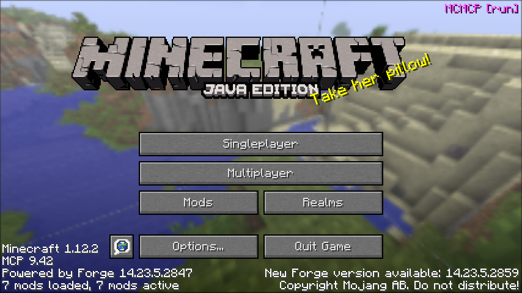
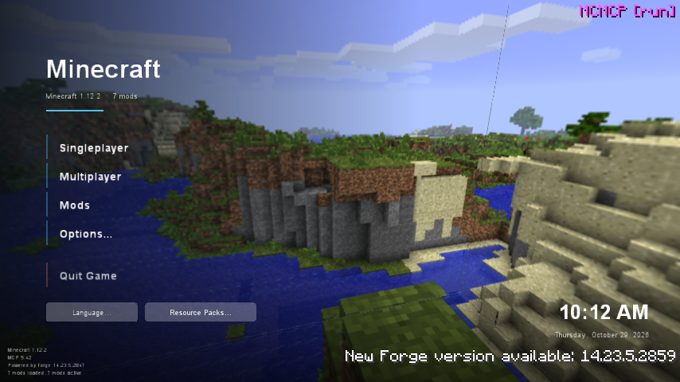
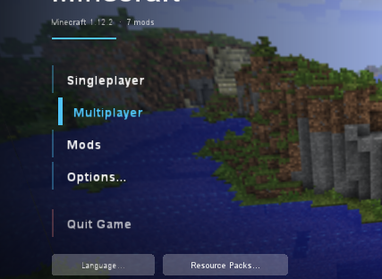
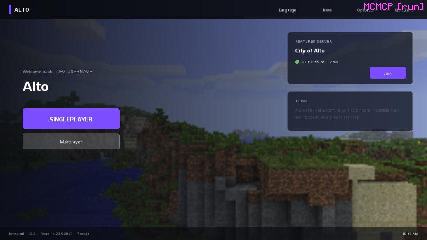
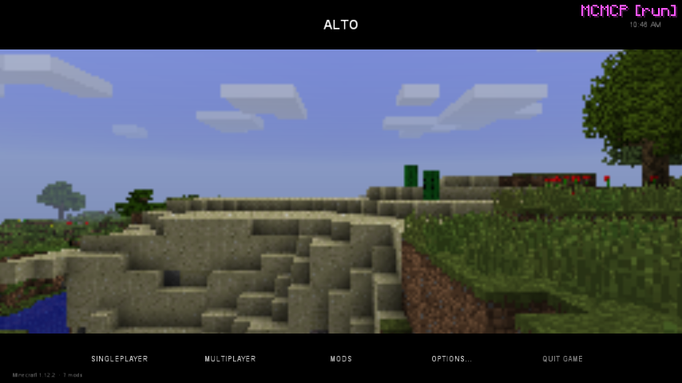

# Built-in themes

Menu themes: `classic`, `horizon`, `launcher`, `premiere`. Loading themes are on the
[loading screen](../loading/index.md) page. Use one directly with `"extends": "builtin:<name>"` in `config/ldic/menu.json`, or as the starting
point for your own.

## classic

`builtin:classic` is the vanilla 1.12 title screen, drawn by LDIC. It looks the same but has a
sharp, full-resolution panorama with light blur. Its buttons use the `vanilla` style, which draws
the active resource pack's `widgets.png`, so a resource pack that restyles vanilla buttons
restyles these too. This is the default for new installs.

{ .shot }

## horizon

`builtin:horizon` is a modern menu: a slow, gently bobbing panorama under a dark gradient, the pack
name in a large system font, and a left-aligned list of buttons with an accent bar that grows on
hover. Buttons slide in one after another when the menu opens. A clock (in the computer's regional
format) and the date sit at the bottom right. It scales with the window height (`design` mode
`height`).

{ .shot }

Keyboard focus (++tab++ / arrow keys) uses the same highlight as the mouse:

{ .shot }

The title shows `pack.name` from [settings](../help/settings.md), or "Minecraft" when that is
empty. The subtitle shows `pack.version` and the mod count.

| Element id | What it is |
| --- | --- |
| `panorama`, `shade_left`, `shade_bottom` | Background and the two gradients over it |
| `menu` | Group holding everything below, centred vertically on the left |
| `title`, `subtitle`, `title_rule` | Pack name, version line, accent rule |
| `play`, `multiplayer`, `mods`, `options`, `quit` | The main buttons |
| `small_language`, `small_packs` | Language and resource pack buttons |
| `clock`, `date`, `branding` | Bottom corners |
| `mod_buttons` | Where other mods' buttons go (top right) |

## launcher

`builtin:launcher` is a game-launcher layout: a top bar with the pack name and secondary buttons,
a large Play button, and optional cards for a **featured server** with live status and for
**news** read from a text file on the web. Turn the cards on with constants:

```json
{
  "ldic": 1,
  "extends": "builtin:launcher",
  "constants": {
    "server_address": "'play.example.com'",
    "server_name": "'Example City'",
    "news_url": "'https://example.com/news.txt'"
  }
}
```

The news file is plain text; each paragraph (lines separated by a blank line) is shown in turn.

{ .shot }

## premiere

`builtin:premiere` is cinematic: scenes slowly pan and crossfade in letterbox, the title sits in
the top bar and the menu is a single row in the bottom bar. Override the `scenes` element's
`images` with screenshots of your world.

{ .shot }

## Examples

The repository has complete themes in
[`docs/examples`](https://github.com/Mica-Technologies/LDIC/tree/main/docs/examples), including
the City of Alto menu converted one-to-one from Custom Main Menu (`alto/menu-classic.json`), a
modern version built on `horizon` with live server status (`alto/menu.json`), and the loading screen
and menu the pack actually ships (`alto/ldic/`, see the [showcase](../loading/index.md#showcase-city-of-alto)).
