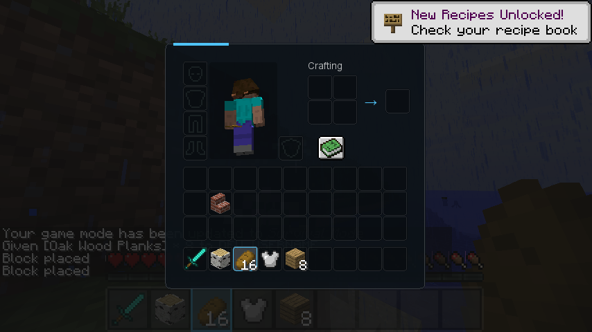
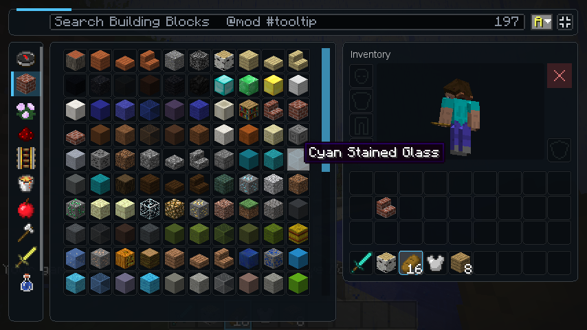

# Inventory screens

A menu theme can also draw the game's inventories. Four screens are recognised:

| Screen | Drawn for |
| --- | --- |
| `inventory` | The survival inventory (E) |
| `crafting` | The crafting table |
| `container` | Chests (small and large), shulker boxes, hoppers, dispensers and droppers |
| `creative` | LDIC's [full-screen creative inventory](../inventory/full-screen.md) |

{ .shot }
{ .shot }

The built-in **horizon**, **launcher** and **premiere** themes have all four, so a theme that
extends one of them gets themed inventories too. **classic** has none, and a screen a theme does
not define keeps Minecraft's own look. Furnaces, brewing stands, enchanting tables, anvils and
other mods' screens are never themed: their backgrounds hold part of how they work.

## How they differ from menu screens

The inventory keeps all of its own behaviour: slots, clicking, dragging, the recipe book,
tooltips and other mods' additions. The theme replaces only what is drawn **behind** the
slots, and the text labels ("Crafting", "Inventory", the chest's name), which it draws itself.

- **One layout unit is one GUI pixel**, whatever the theme's `design` says, so the theme lines up
  with the slots. Full-screen (scaled-up) inventories scale the theme with them.
- **Slots cannot move.** A [`slots`](elements.md#slots) element decorates them where they are,
  and [`player_model`](elements.md#player_model) draws the player.
- **Areas** tell the theme where things are: `area_x('panel')`, `area_y`, `area_w`, `area_h`.

| Area | Where |
| --- | --- |
| `panel` | The inventory's panel (vanilla's 176-pixel-wide box); the whole screen on `creative` |
| `main`, `hotbar`, `armor`, `offhand`, `player` | Around those slots (`player` is all of them) |
| `crafting`, `result` | The crafting grid and its result slot |
| `container` | The chest's (or hopper's, ...) own slots |
| `top`, `sidebar`, `browser`, `inventory`, `search`, `scrollbar`, `model`, `trash` | `creative` only: LDIC's full-screen layout |

On `creative`, LDIC still draws the working parts itself (search box, sort and full-screen
buttons, tab list, scrollbar, trash), in the theme's `accent` colour; the theme draws the panels,
slot cells, labels and player around them.

## Example

```json
"screens": {
  "inventory": {
    "elements": [
      { "id": "inv_panel", "type": "rect", "radius": 4, "colour": "#E60C1218", "border_colour": "#30FFFFFF",
        "x": "area_x('panel') - 6", "y": "area_y('panel') - 6",
        "width": "area_w('panel') + 12", "height": "area_h('panel') + 12" },
      { "id": "inv_model", "type": "player_model",
        "x": "area_x('panel') + 26", "y": "area_y('panel') + 8", "width": 49, "height": 70 },
      { "id": "inv_slots", "type": "slots", "radius": 2, "colour": "#48000000",
        "border_colour": "#1CFFFFFF", "selected_border_colour": "accent" },
      { "id": "inv_crafting_label", "type": "text", "font": "ui", "size": 9, "shadow": false,
        "text": "{translate('container.crafting')}",
        "x": "area_x('crafting')", "y": "area_y('crafting') - 11" }
    ]
  },
  "container": {
    "elements": [
      { "id": "chest_frame", "type": "include", "screen": "inventory", "ids": ["inv_panel", "inv_slots"] },
      { "id": "chest_title", "type": "text", "font": "ui_bold", "size": 9, "text": "{container_title}",
        "x": "area_x('container')", "y": "area_y('container') - 11" }
    ]
  }
}
```

To keep Minecraft's look for one screen while extending a built-in theme, remove its elements:
`"inventory": { "remove": ["inv_panel", "inv_rule", "inv_model_box", "inv_model", "inv_slots", "inv_crafting_label", "inv_arrow"] }`.
A pack turns inventory theming off altogether with `"inventory": { "themed": false }` in
[settings.json](../help/settings.md).

If an inventory screen's theme fails while drawing, LDIC logs it and uses Minecraft's look for
the rest of the session.
