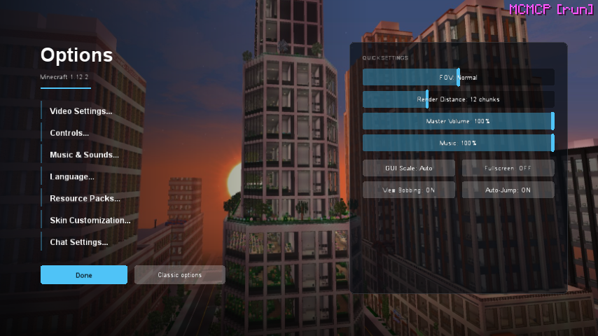
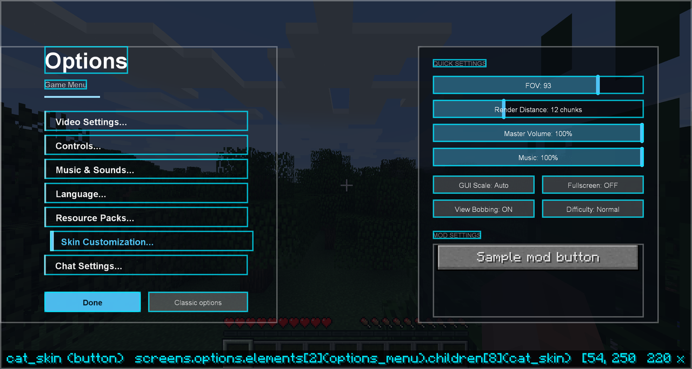

# Options screen

A menu theme can also restyle Minecraft's **Options** screen, from the title screen and from the
pause menu. Give the theme a screen named `options` and LDIC uses it in place of vanilla's. Themes
without one keep vanilla's options screen. `builtin:horizon`, and every theme that extends it,
has one.

{ .shot }

## What stays vanilla

- **The sub-screens.** Video Settings, Controls, Music & Sounds, Language, Resource Packs, Skin
  Customization and Chat Settings are Minecraft's own screens (and OptiFine's, where it replaces
  them), opened as they are.
- **Other mods' buttons.** Mods that add a button to the options screen still do, and a theme can
  **never** hide them here. They go into the theme's `foreign_buttons` area, or stay where the mod
  put them. The value `foreign_buttons` tells a theme how many there are, for a "Mod settings"
  heading.
- **Mod config screens** open as each mod draws them.
- **A way out.** The `classic_options` action opens vanilla's own options screen, once. Turn the
  themed screen off entirely with `"themed_options": false` under `menu` in
  [settings](../help/settings.md).

## Building one

```json
"screens": {
  "main": { … },
  "options": {
    "elements": [
      { "id": "background", "type": "include", "screen": "main", "ids": ["panorama", "shade"], "visible": "!in_world" },
      { "id": "dim", "type": "rect", "colour": "#C0000000", "visible": "in_world" },
      { "type": "button", "text": "{translate('options.video')}", "action": { "type": "open", "screen": "video" } },
      { "type": "slider", "option": "FOV", "y": 30 },
      { "type": "slider", "option": "sound:music", "y": 56 },
      { "type": "button", "text": "{option_text('VIEW_BOBBING')}", "y": 82, "action": { "type": "option", "name": "VIEW_BOBBING" } },
      { "type": "button", "text": "{difficulty_text()}", "y": 108, "visible": "in_world",
        "enabled": "can_change_difficulty()", "action": "difficulty" },
      { "type": "foreign_buttons", "y": 140, "height": 80 },
      { "type": "button", "text": "{translate('gui.done')}", "anchor": "bottom", "y": -20, "action": "back" }
    ]
  }
}
```

- **`include`** copies elements from another screen, so the options screen shows the same background
  as the main menu. A theme that changes the main background (like the City of Alto's scenes)
  changes the options background with it.
- **`in_world`** is true when the screen was opened from the pause menu: show the world dimmed behind
  instead of the menu art.
- **`back`** (and Escape) saves the options and returns to where the screen was opened from: the
  title screen or the pause menu.

{ .shot }

*In a world, with `debug` on: element outlines, and LDIC's sample mod button in the Mod settings area.*

## Game options by name

Sliders and the `option` action take an option name:

| Kind | Names |
| --- | --- |
| Sliders | `FOV`, `RENDER_DISTANCE`, `SENSITIVITY`, `GAMMA`, `FRAMERATE_LIMIT`, `CHAT_OPACITY`, `CHAT_SCALE`, `CHAT_WIDTH`, `MIPMAP_LEVELS`, … |
| Volumes (sliders) | `sound:master`, `sound:music`, `sound:record`, `sound:weather`, `sound:block`, `sound:hostile`, `sound:neutral`, `sound:player`, `sound:ambient`, `sound:voice` |
| Toggles and choices (`option` action) | `GUI_SCALE`, `USE_FULLSCREEN`, `VIEW_BOBBING`, `AUTO_JUMP`, `ENABLE_VSYNC`, `GRAPHICS`, `PARTICLES`, `RENDER_CLOUDS`, `AMBIENT_OCCLUSION`, `ENTITY_SHADOWS`, `SHOW_SUBTITLES`, `MAIN_HAND`, `ATTACK_INDICATOR`, `NARRATOR`, … |

The names are Minecraft's own `GameSettings.Options`. `option_text(name)` gives the label vanilla
would show ("FOV: 70", "Music: 100%"), and `option_value(name)` the slider position (0–1) or 1/0 for
toggles. Changes are saved to `options.txt` when a slider is released and when the screen closes.

Sliders work with the mouse, and with the arrow keys when focused (hold Shift for bigger steps).
