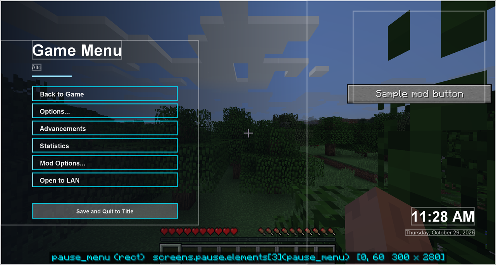
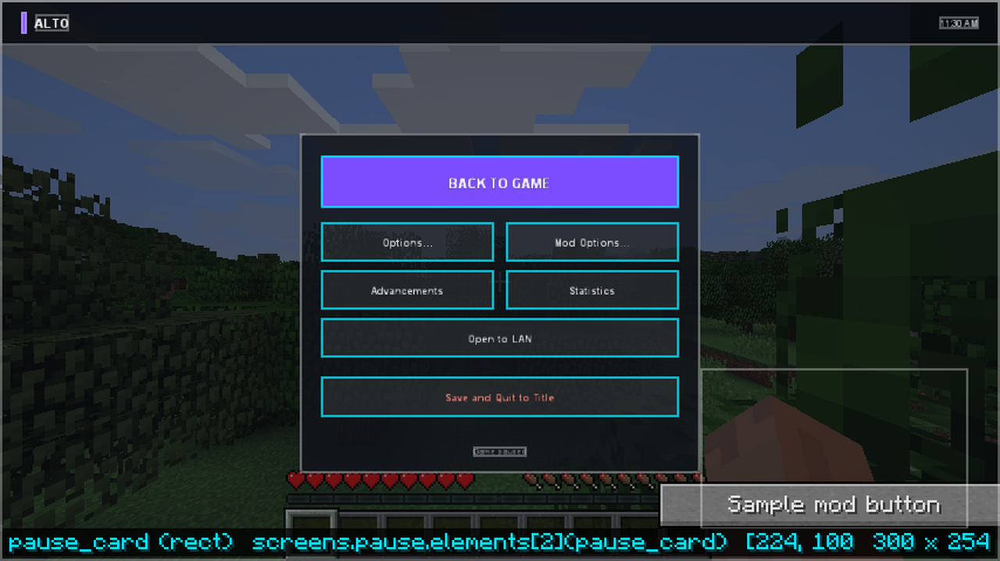
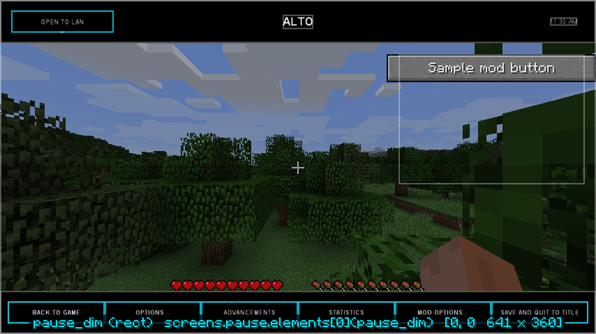

# Pause menu

A menu theme can restyle the pause menu (the Escape menu in a world) too. Give the theme a screen
named `pause` and LDIC uses it in place of vanilla's. Themes without one keep vanilla's pause menu.
The built-in `horizon`, `launcher` and `premiere`, and every theme that extends them, have one.

{ .shot }

*horizon, as the City of Alto menu (`debug` on).*

## What stays vanilla

- **The screens it opens.** Options (the [themed one](options.md), if the theme has it),
  Advancements, Statistics, Open to LAN and Mod Options are the usual screens.
- **Other mods' buttons.** Mods that add a button to the pause menu still do, and a theme can
  **never** hide them here. They go into the theme's `foreign_buttons` area, or stay where the mod
  put them.
- **Leaving the world** works as vanilla's button does: to the title screen from singleplayer, to the
  server list from a server, to Realms from Realms.
- **A way out.** The `classic_pause` action opens vanilla's pause menu, once. Turn the themed one off
  entirely with `"themed_pause": false` under `menu` in [settings](../help/settings.md).

## Building one

```json
"pause": {
  "elements": [
    { "type": "rect", "colour": "#80000000" },
    { "type": "button", "text": "{translate('menu.returnToGame')}", "action": "resume" },
    { "type": "button", "text": "{translate('menu.options')}", "y": 24, "action": { "type": "open", "screen": "options" } },
    { "type": "button", "text": "{translate('gui.advancements')}", "y": 48, "action": { "type": "open", "screen": "advancements" } },
    { "type": "button", "text": "{translate('gui.stats')}", "y": 72, "action": { "type": "open", "screen": "statistics" } },
    { "type": "button", "text": "{translate('fml.menu.modoptions')}", "y": 96, "action": { "type": "open", "screen": "mod_options" } },
    { "type": "button", "text": "{translate('menu.shareToLan')}", "y": 120, "visible": "singleplayer && !lan_open",
      "action": { "type": "open", "screen": "lan" } },
    { "type": "button", "text": "{translate('selectWorld.allowCommands')} {translate(cheats ? 'options.on' : 'options.off')}",
      "y": 144, "visible": "singleplayer", "action": "cheats" },
    { "type": "button", "text": "{translate(singleplayer ? 'menu.returnToMenu' : 'menu.disconnect')}", "y": 174, "action": "disconnect" },
    { "type": "foreign_buttons", "anchor": "top_right", "width": 200, "height": 120 }
  ]
}
```

- The world shows behind the screen: draw a translucent rect rather than an opaque background.
- `singleplayer` and `lan_open` tell the screen what kind of game it is in.
- The `cheats` action switches the world's Allow Cheats setting without opening to LAN, and
  `cheats` says whether it is on. The built-in pause menus have this button.
- `include` can borrow parts of the main screen, such as horizon's clock:
  `{ "type": "include", "screen": "main", "ids": ["clock", "date"] }`.
- Escape, and the `back` action, return to the game.

{ .shot }

*launcher*

{ .shot }

*premiere*
