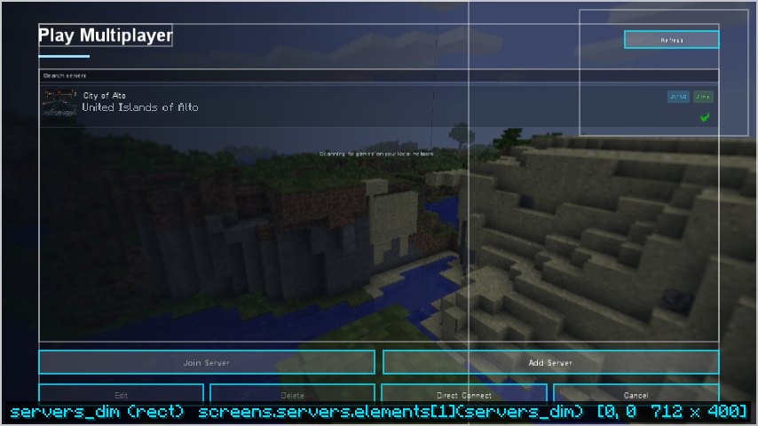

# Server list

A menu theme's `servers` screen replaces the multiplayer server list. All of vanilla's behaviour
is kept and runs vanilla's own code: the saved list, finding LAN games, pinging, joining, adding,
editing and deleting servers (with their confirmations), Direct Connect and Refresh. Forge's
marker for modded servers (compatible, incompatible or blocked) and its tooltip stay on each
server. Other mods' buttons stay too, in the theme's
[`foreign_buttons`](elements.md#foreign_buttons) area.

{ .shot }

The built-in **horizon**, **launcher** and **premiere** themes have one; **classic** keeps
vanilla's screen. A pack turns it off with `"menu": { "themed_servers": false }` in
[settings.json](../help/settings.md).

## The list

A [`list`](elements.md#list) element with `"source": "servers"` draws each saved server as a card:
its icon, name and message of the day (in the server's own colours), a players badge (hover it for
who is online), the ping in milliseconds (green to red) or Offline / Pinging, and a warning for a
server on another game version. LAN games follow, then vanilla's "scanning" line. The search box
filters by name, address or LAN game name.

- Click a server to select it; double-click it, or click its icon, to join.
- Up and Down move the selection, Shift+Up / Shift+Down move a saved server in the list (as in
  vanilla), Enter joins, F5 refreshes, Ctrl+F searches.

## Actions and values

| Action | Does |
| --- | --- |
| `server_join` | Joins the selected server or LAN game |
| `server_direct` | Direct Connect |
| `server_add` | Add Server |
| `server_edit` | Edits the selected saved server |
| `server_delete` | Deletes the selected saved server, after vanilla's confirmation |
| `server_refresh` | Pings everything again |

| Value | Type | Meaning |
| --- | --- | --- |
| `server_selected` | bool | A server or LAN game is selected (for Join) |
| `server_editable` | bool | A saved server is selected (for Edit and Delete) |
| `server_count` | number | How many saved servers there are |
