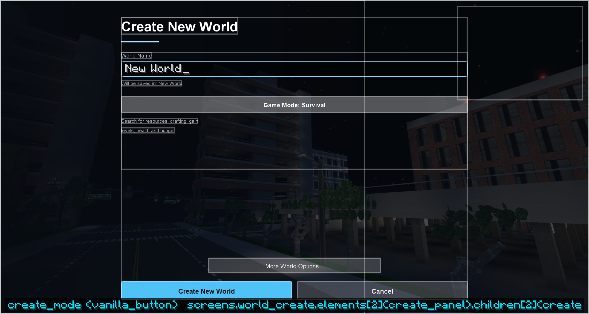

# Skins for other screens

Some vanilla screens are **skinned** rather than replaced: the screen keeps all of its own logic
(its buttons, text fields, state and every click and key), and the menu theme only redraws it.
Four elements bring the screen's own widgets into the theme's layout:

- [`vanilla_button`](elements.md#vanilla_button) takes one of the screen's buttons by its id,
  moves it into the element's box and draws it with the button styles. Its label, whether it is
  enabled or shown, and what clicking it does stay the screen's.
- [`vanilla_field`](elements.md#vanilla_field) takes one of the screen's text fields (by its order
  in the screen, from 0) and draws it in a themed box. Typing goes to the field as before.
- [`vanilla_grid`](elements.md#vanilla_grid) lays out every vanilla button the theme did not place
  (except the ids in `exclude`) in columns, button-styled. Sliders keep working and show their
  position as a bar. Settings screens with many options use this.
- [`vanilla_list`](elements.md#vanilla_list) moves one of the screen's scrolling lists (by order,
  from 0) into the box, at the theme's scale and without the dirt background. Scrolling, selecting
  and clicking stay the list's. With `style_buttons`, buttons inside its rows use its button styles.

A vanilla button a skin does not place is not lost: it appears in the theme's
`foreign_buttons` area with other mods' buttons (or where the screen put it).

| Theme screen | Skins | Buttons (id) | Fields and lists |
| --- | --- | --- | --- |
| `world_create` | Create New World | 0 Create, 1 Cancel, 2 Game Mode, 3 More World Options / Done, 4 Generate Structures, 5 World Type, 6 Allow Cheats, 7 Bonus Chest, 8 Customize | 0 name, 1 seed |
| `world_edit` | Edit World | 0 Save, 1 Cancel, 3 Reset Icon, 4 Open Folder | 0 name |
| `server_edit` | Add Server, Edit Server | 0 Done, 1 Cancel, 2 Server Resource Packs | 0 address, 1 name |
| `server_direct` | Direct Connect | 0 Join Server, 1 Cancel | 0 address |
| `lan_share` | Open to LAN | 101 Start LAN World, 102 Cancel, 103 Allow Cheats, 104 Game Mode | |
| `death` | You Died | 0 Respawn (or Spectate), 1 Title Screen | |
| `disconnected` | Disconnected | 0 Back | |
| `confirm` | Confirmations (delete world, delete server, ...) | 0 Yes, 1 No | |
| `options_sounds` | Music & Sounds | 200 Done; the volume sliders and subtitles (grid) | |
| `options_chat` | Chat Settings | 200 Done; the chat options (grid) | |
| `options_skin` | Skin Customization | 200 Done; the skin parts and main hand (grid) | |
| `options_language` | Language | 6 Done, 100 Force Unicode Font | list 0 languages |
| `options_video` | Video Settings | 200 Done | list 0 options |
| `options_controls` | Controls | 200 Done, 201 Reset Keys; the mouse options (grid) | list 0 key bindings |
| `packs` | Resource Packs | 1 Done, 2 Open Folder | list 0 available, list 1 selected |
| `advancement_tree` | Advancements | none (add a theme `button` with `"action": "back"`); draw it with [advancement_map](elements.md#advancement_map) and [advancement_tabs](elements.md#advancement_tabs) | |
| `player_stats` | Statistics | 0 Done, 1 General, 2 Blocks, 3 Items, 4 Mobs | list `shown` (the list the screen is showing) |
| `chat_bar` | Chat (the typing bar) | none; the bar is field 0 | 0 message |
| `chat_bed` | Chat while in bed | 1 Leave Bed | 0 message |

Only the exact vanilla class is skinned: another mod's screen built on one of these stays as it is.
Screens that can open in a world (death, LAN, settings) should cover the world lightly rather than
show the menu background: the built-ins switch on `in_world`.

{ .shot }

The built-in **horizon**, **launcher** and **premiere** themes skin all of these; **classic** leaves them
[settings.json](../help/settings.md).

## Values

| Function | Returns |
| --- | --- |
| `vanilla_text(id)` | A button's label |
| `vanilla_visible(id)`, `vanilla_enabled(id)` | Whether a button is shown, and usable |
| `field_visible(i)` | Whether a text field is shown |
| `screen_text(name)`, `screen_flag(name)` | Strings and switches particular to the screen (below) |

Screen values: death `screen_text('cause')`, `'score'` and `screen_flag('hardcore')`; disconnected
`screen_text('reason')` and `'message'`; confirm `screen_text('line1')` (the question) and `'line2'`.

Create New World: `screen_text('folder')` (the save folder name), `screen_text('mode_hint1')` and
`'mode_hint2'` (the game mode's description), `screen_text('world_type_info')` (the world type's
notice, if any) and `screen_flag('more_options')` (the More World Options page is showing; the
screen shows and hides its own buttons to match, so lay both pages out and let `visible` follow).

Advancements: `screen_text('tab')` (the selected tab's title), `screen_text('tabs')` (how many tabs)
and `screen_flag('empty')` (no advancements to show). Statistics: `screen_flag('loading')` while the
server sends the stats (the screen has no buttons or lists until then).

The chat skins draw only the bar (and Leave Bed); the chat lines above it stay vanilla's, and a
chat link's hover box still shows. Size the bar in GUI pixels (`16 / ui_scale`) so it keeps clear
of the chat lines, which start 48 GUI pixels above the bottom.
