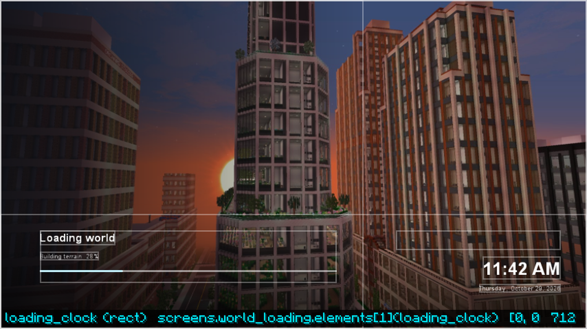
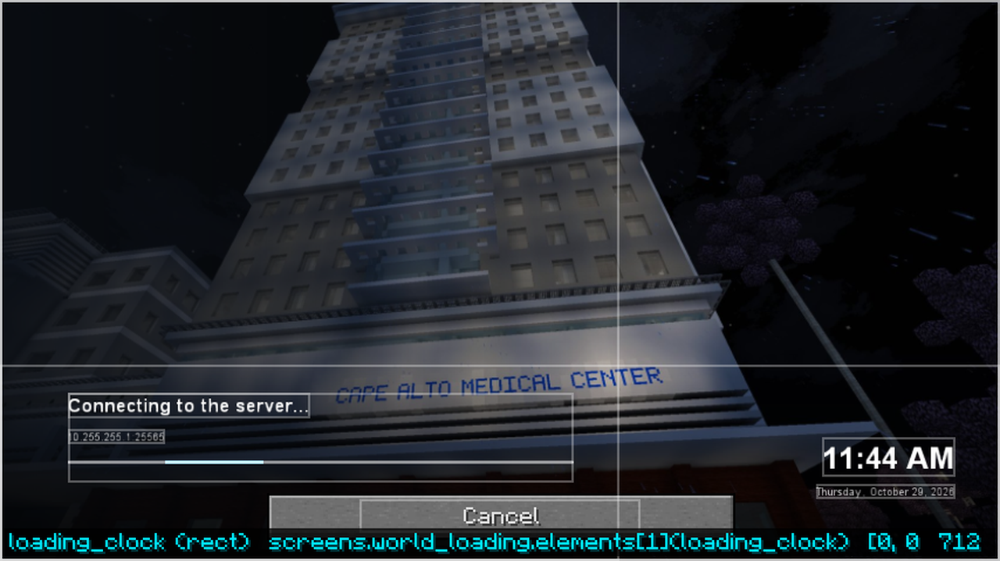

# World loading

Between pressing Play and standing in the world, Minecraft shows a few plain screens: "Loading
world", "Building terrain", "Connecting to the server", "Loading terrain", and "Shutting down"
when leaving. A menu theme can replace all of them with one screen named `world_loading`. Themes
without one keep vanilla's. The built-in `horizon`, `launcher` and `premiere`, and every theme that
extends them, have one.

{ .shot }

*horizon as the City of Alto menu, while a new world generates (`debug` on).*

## What it shows

| Value | Type | Meaning |
| --- | --- | --- |
| `status` | string | What the game is doing: "Loading world", "Connecting to the server...", "Loading terrain", ... |
| `status_detail` | string | The step, when there is one ("Building terrain"), or the server's name while connecting |
| `status_progress` | number | 0 to 1, or -1 when the step has no progress to report |

Singleplayer worlds report real progress while the spawn area generates, which vanilla never
shows. Draw a moving bar when `status_progress` is -1:

```json
"world_loading": {
  "elements": [
    { "type": "include", "screen": "main", "ids": ["background"] },
    { "type": "text", "text": "{status}", "anchor": "bottom_left", "x": 40, "y": -60, "size": 18 },
    { "type": "text", "text": "{status_detail}", "anchor": "bottom_left", "x": 40, "y": -36 },
    { "type": "rect", "anchor": "bottom_left", "x": 40, "y": -24, "width": 300, "height": 3, "colour": "#30FFFFFF", "children": [
      { "type": "rect", "width": "pw * clamp(status_progress, 0, 1)", "colour": "#4FC3F7", "visible": "status_progress >= 0" },
      { "type": "rect", "x": "(pw - 60) * (0.5 + 0.5 * sin(time * 160))", "width": 60, "colour": "#4FC3F7", "visible": "status_progress < 0" }
    ] },
    { "type": "foreign_buttons", "anchor": "bottom", "y": -20, "width": 200, "height": 24 }
  ]
}
```

- The screen is not clickable itself: only vanilla's own **Cancel** button (while connecting) is,
  and it works as it always does. Put a `foreign_buttons` area where it should go; without one it
  stays where vanilla puts it.
- `screen_time` keeps counting from the first loading step to the last, so entrance animations
  play once, not again at every step.
- The theme draws over a black screen; draw a full background, usually with `include`.

{ .shot }

## Smoothness

LDIC keeps drawing at the loading-screen frame cap (`loading.fps` in
[settings](../help/settings.md)) while vanilla waits for the world. A few steps still block the
game for a fraction of a second (starting the internal server, building the client's world), and
the animation pauses there; vanilla's screen freezes at the same moments.

Turn the screen off with `"themed_world_loading": false` under `menu` in
[settings](../help/settings.md).
