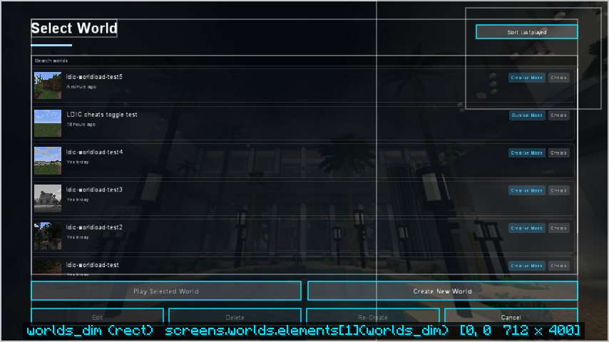

# World selection

A menu theme's `worlds` screen replaces the singleplayer world list. Every vanilla function is
still there and runs vanilla's own code: playing a world (with the warning for worlds from a
newer version), creating, editing, deleting (with its confirmation) and re-creating. Other mods'
buttons on the world list keep working, in the theme's
[`foreign_buttons`](elements.md#foreign_buttons) area.

{ .shot }

The built-in **horizon**, **launcher** and **premiere** themes have one; **classic** keeps
vanilla's screen. A pack turns it off with `"menu": { "themed_worlds": false }` in
[settings.json](../help/settings.md).

## The list

A [`list`](elements.md#list) element with `"source": "worlds"` draws the worlds as cards: the
world's icon, its name, how long ago it was last played (and its folder, when that differs from
the name), and badges for game mode, hardcore, cheats and version warnings (hover a warning for
vanilla's explanation). A search box across the top filters by name or folder.

- Click a card to select it; double-click it, or click its icon, to play.
- Up and Down move the selection, Enter plays, Ctrl+F searches, the mouse wheel scrolls.

## Actions and values

| Action | Does |
| --- | --- |
| `world_play` | Plays the selected world |
| `world_create` | Opens Create New World |
| `world_edit` | Opens Edit World for the selected world |
| `world_delete` | Deletes the selected world, after vanilla's confirmation |
| `world_recreate` | Re-creates the selected world (a new world with its settings) |
| `world_sort` | Switches the order: last played, or name |

| Value | Type | Meaning |
| --- | --- | --- |
| `world_selected` | bool | A world is selected; use it for `enabled` on the buttons that need one |
| `world_count` | number | How many worlds there are |
| `world_sort` | string | `recent` or `name` |
